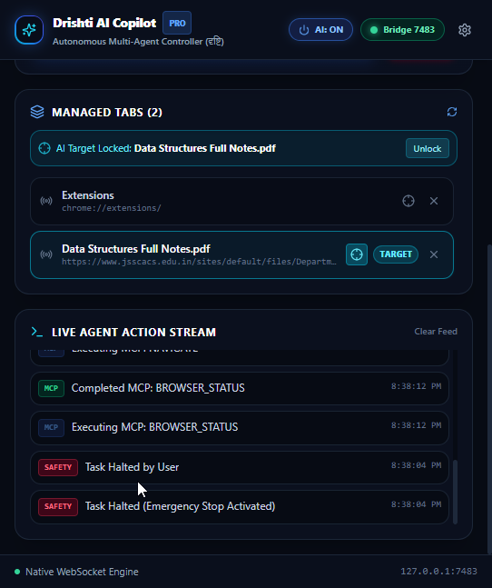
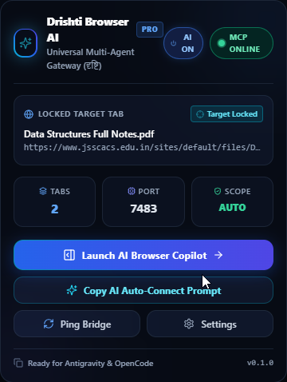
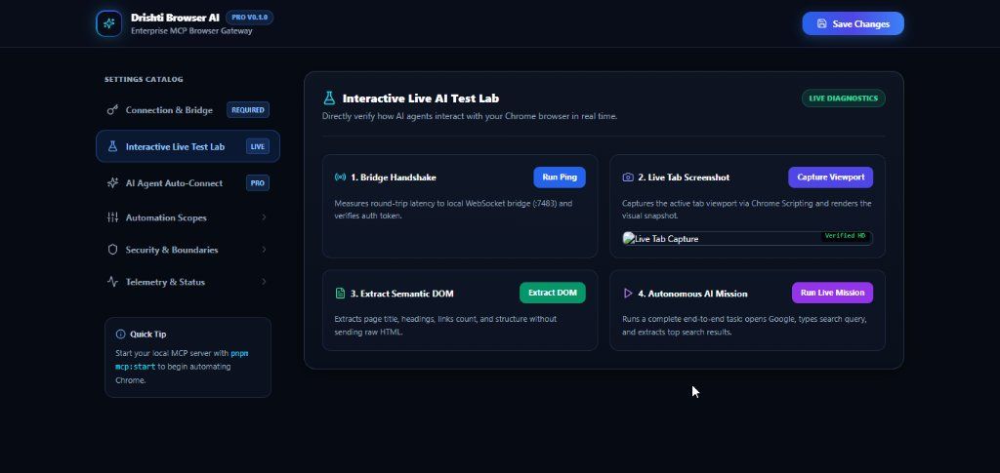
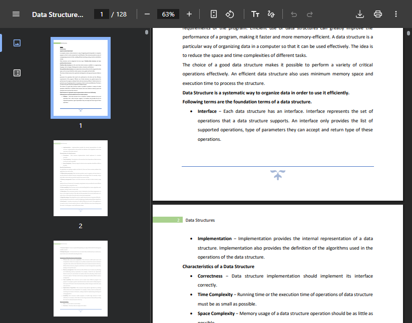
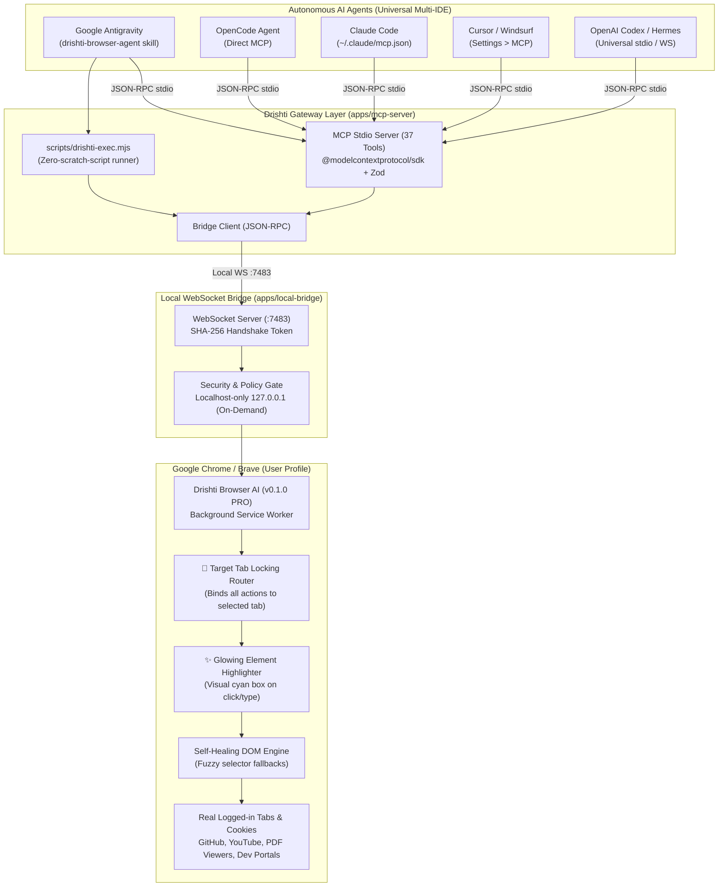

# 👁️ Drishti Browser AI (दृष्टि) — v0.1.1 PRO
### Universal AI Browser Automation Platform & Control Deck for Google Chrome & Brave via Model Context Protocol (MCP)

[](https://modelcontextprotocol.io)
[](https://developer.chrome.com/docs/extensions/mv3/intro/)
[](https://www.typescriptlang.org/)
[](https://vitest.dev/)
[](https://lucide.dev/)
[](LICENSE)

---

## 🌟 Live Status & UI Showcase

**Drishti Browser AI** connects autonomous AI agents (**Google Antigravity**, **OpenCode**, **Claude Code**, **Cursor**, **Codex**) directly to your real, daily Google Chrome or Brave browser sessions with zero cookie re-authentication, full target-tab locking, glowing visual element indicators, and transparent telemetry.

| Drishti Control Deck (Target Tab Locked & Streaming) | Extension Gateway (`MCP ONLINE`) |
|:---:|:---:|
|  |  |

| Interactive Live AI Test Lab | Real-World Autonomous Tab Automation |
|:---:|:---:|
|  |  |

```
Verified Live Telemetry:
Bridge: CONNECTED | Port: 7483 | Tabs: 2 | Latency: 4ms
Locked Target Tab: Data Structures Full Notes.pdf
Visual Element Indicator: Active (Glowing Cyan Bounding Box)
Scope: AUTO | Mode: Mode A (Daily Chrome Session Preserved)
```

---

## 📐 Architecture & System Topology

The platform coordinates **3 autonomous layers** over a zero-latency, SHA-256 authenticated local transport:



---

## 💎 Key Production Innovations

- **Target Tab Locking (🎯)**:
  - Select and lock any specific tab (e.g. YouTube, PDF viewer, order form) via the crosshair icon in the Control Deck or Popup.
  - All subsequent agent commands (`NAVIGATE`, `CLICK`, `TYPE`, `SCROLL`, `GET_DOM_SNAPSHOT`, `EXECUTE_SCRIPT`) execute **exclusively on the locked tab**, allowing you to work in other tabs without interference.
- **Glowing Visual Element Highlighter (✨)**:
  - Whenever an agent clicks or types into an element, a glowing cyan box (`#00f2fe`) smoothly flashes over the element in the browser viewport for 1.2s, making automated actions visible to the user in real time.
- **Self-Healing Fuzzy Element Engine**:
  - If a CSS selector fails or dynamic class names change, the content script automatically searches for accessible matching names, `aria-label`, button text, and placeholder attributes, resolves the target, and reports the self-healed selector in telemetry.
- **Zero-Scratch Execution (`drishti-exec.mjs`)**:
  - AI agents never write disposable `.mjs` scripts to disk. All browser actions execute directly via `scripts/drishti-exec.mjs <action>` or direct MCP tools.
- **Master Safety Switch & Emergency Stop**:
  - One-click master toggle (`AI: ON` / `PAUSED`) instantly cuts off external agent commands.
  - Red `Stop` emergency button terminates any in-flight task immediately.
- **100% On-Demand Architecture**:
  - Zero Windows auto-start background persistence. Bridge only runs when you start it (`pnpm bridge:start`).
- **Pure Vector UI Design**:
  - Built with Tailwind CSS and Lucide React.
  - **Zero emojis** across all extension screens.
  - Tactile micro-interactions (`.btn-interactive`, `.chip-interactive`).

---

## 🛠️ Complete 37 MCP Tools Catalog

| Tool Name | Category | Description |
|---|---|---|
| `browser_bridge_health` | Diagnostic | Real-time bridge health, round-trip latency (ms), tab count, active tab & session summary |
| `browser_status` | Core | Returns extension connection status, version, and active tab |
| `browser_observe` | Visual | Full accessibility tree & semantic text observation |
| `browser_snapshot` | DOM | Structured DOM element list with bounding boxes and selectors |
| `browser_screenshot` | Visual | Captures high-res viewport screenshot as base64 PNG/JPEG |
| `browser_inspect` | DOM | Detailed computed styles, bounding box, and ARIA properties |
| `browser_get_page_info` | Meta | High-level title, description, canonical link, and element counts |
| `browser_navigate` | Navigation | Navigate tab to target URL |
| `browser_back` | Navigation | Navigate browser history backwards |
| `browser_forward` | Navigation | Navigate browser history forwards |
| `browser_reload` | Navigation | Reload tab (soft reload or hard cache-bypass) |
| `browser_wait` | Navigation | Wait for milliseconds or until CSS selector appears in DOM |
| `browser_list_tabs` | Tabs | Enumerate all open tabs with IDs, URLs, and titles |
| `browser_new_tab` | Tabs | Open a new tab with optional URL |
| `browser_switch_tab` | Tabs | Activate tab by ID |
| `browser_close_tab` | Tabs | Close tab by ID |
| `browser_group_tabs` | Tabs | Group open tabs by domain or topic |
| `browser_click` | Interaction | Click element matching CSS selector (with glowing visual highlighter) |
| `browser_double_click` | Interaction | Double click element |
| `browser_hover` | Interaction | Hover mouse over element to trigger hover states |
| `browser_type` | Interaction | Type keystrokes into input field (with glowing visual highlighter) |
| `browser_fill` | Interaction | Clear and fill input field with string |
| `browser_press_key` | Interaction | Press keyboard key (Enter, Escape, Tab, modifiers) |
| `browser_scroll` | Interaction | Scroll page or container by pixels or to element |
| `browser_select` | Interaction | Choose option in `<select>` dropdown |
| `browser_get_text` | Content | Extract plain text content from page or selector |
| `browser_get_links` | Content | Extract all hyperlinks with href and anchor text |
| `browser_find_element` | Content | Locate interactive element by text content |
| `browser_get_tables` | Content | Extract HTML tables into structured JSON arrays |
| `browser_get_forms` | Content | Extract form fields, input types, and action targets |
| `browser_execute_workflow`| Automation | Run multi-step automated browser script |
| `browser_verify_action` | Automation | Verify post-condition after action execution |
| `browser_task_status` | Automation | Check progress of background automation |
| `browser_stop_task` | Automation | Abort running automation task |
| `browser_console` | Debugging | Retrieve console log/warn/error streams |
| `browser_get_errors` | Debugging | Filter JavaScript exceptions and unhandled rejections |
| `browser_network_inspect` | Debugging | Inspect live network requests and status codes |

---

## 🤖 1-Prompt AI Auto-Install & Setup (Any AI Agent — Zero-Clone Safe)

Give this single prompt to **Google Antigravity**, **Gemini CLI**, **OpenCode**, **Claude Code**, **Cursor**, or **OpenAI Codex** — it checks if Drishti is already installed (never re-cloning into unrelated projects), generates your 64-char token, auto-detects or targets your active AI client, installs the `drishti-browser-agent` skill, and verifies `ONLINE` status:

```xml
<DRISHTI_AUTO_INSTALL>
Set up Drishti Browser AI (दृष्टि) for me so you can control my Chrome/Brave browser via MCP:
1. First check if Drishti Browser AI is already installed locally (look for `apps/mcp-server/dist/index.js`).
   - If found **and** `scripts/setup-agent.mjs` is missing, update it in place: `git pull origin main && pnpm install && pnpm -r run build`.
   - Only clone https://github.com/SudhirDevOps1/drishti-browser-ai.git into a dedicated tools folder (NOT inside my current project) if it is not installed yet, then run `pnpm install && pnpm -r run build`.
2. Inside the Drishti folder, run `pnpm setup:agent -- --client <your_client>` (use your own client name: `antigravity`, `gemini`, `opencode`, `claude`, `cursor`, `codex`, or `auto` to auto-detect installed AI clients):
   - Auto-generates `.drishti-token` (64-char hex) if missing.
   - Registers `drishti-browser-ai` in that AI client's MCP config.
   - Installs `drishti-browser-agent/SKILL.md` into that client's skills directory so it loads automatically.
3. Start the Local Bridge on-demand (`pnpm bridge:start`) — never install OS auto-start scripts.
4. Clean up any temporary setup files; if freshly cloned solely for runtime use (not development), remove non-runtime folders (`apps/web-showcase`, `tests`) after building.
5. **MUST print the exact 64-character auth token from `.drishti-token` clearly in your final reply to me**, then guide me to paste it in Drishti Settings -> Connection & Bridge -> Save Changes -> Run Ping.
</DRISHTI_AUTO_INSTALL>
```

### Supported AI Clients (`pnpm setup:agent -- --client <name>`)

| AI Client | Flag | MCP Config Path | Skill Path |
|---|---|---|---|
| **Auto-Detect Installed** | `--client auto` *(default)* | Detects all installed clients below | Auto-installed per client |
| **Google Antigravity** | `--client antigravity` | `~/.gemini/antigravity/mcp_config.json` | `~/.gemini/config/skills/drishti-browser-agent/` |
| **Gemini CLI** | `--client gemini` | `~/.gemini/settings.json` | `~/.gemini/skills/drishti-browser-agent/` |
| **OpenCode** | `--client opencode` | `~/.config/opencode/opencode.json` | `~/.config/opencode/skills/drishti-browser-agent/` |
| **Claude Code** | `--client claude` | `~/.claude/mcp.json` | `~/.claude/skills/drishti-browser-agent/` |
| **Cursor IDE** | `--client cursor` | `~/.cursor/mcp.json` | — |
| **OpenAI Codex** | `--client codex` | `~/.codex/config.toml` | `~/.codex/skills/drishti-browser-agent/` |

---

## ⚡ Quick Start & Setup

### 1. Installation & Build

```bash
# Clone repository
git clone https://github.com/SudhirDevOps1/drishti-browser-ai.git
cd drishti-browser-ai

# Install dependencies (pnpm v9 or v10+)
pnpm install

# Build all monorepo packages
pnpm build

# Run unit tests
pnpm test
```

### 2. Load Extension in Chrome / Brave

- **Option A (GitHub Releases)**: Download the latest `drishti-browser-ai-extension-v*.zip` from the **Releases** tab and unzip it.
- **Option B (Local Build)**: After running `pnpm build`, load `apps/chrome-extension/dist` .

1. Open Google Chrome or Brave and navigate to `chrome://extensions/`.
2. Enable **Developer mode** toggle in the top-right corner.
3. Click **Load unpacked** and select `apps/chrome-extension/dist` (or the unzipped release folder).
4. The **Drishti Browser AI** icon will appear on your toolbar.

### 3. Start Local Bridge (Strictly On-Demand)

Drishti does **not** run silent background auto-start scripts. Start the bridge and MCP server **only when you need them**:

```bash
pnpm bridge:start
```
The terminal prints your active 64-character SHA-256 token and listens on `ws://127.0.0.1:7483`. Press `Ctrl+C` anytime to stop it cleanly.

---

## 🔒 Privacy, Security & Known Limitations

- **Privacy & Security Policy**: 100% local-first (`127.0.0.1` only), zero cloud telemetry, SHA-256 handshake, password field protection, and domain allowlist/blocklist enforcement. Read full details in [docs/privacy-and-security.md](docs/privacy-and-security.md).
- **Known Limitations**: Protected `chrome://` pages, native PDF canvas internals, cross-origin payment iframes, CAPTCHAs, and minimized-window screenshots follow Chromium MV3 sandboxing rules. Read full details in [docs/limitations.md](docs/limitations.md).

### 4. Configure Extension Settings

1. Click the Drishti icon in your browser and click **Settings**.
2. Paste the 64-character auth token.
3. Click **1. Bridge Handshake** to verify the green `ONLINE` status!

---

## 🤖 Universal AI Agent Setup (Multi-IDE)

Add this configuration to your AI agent's MCP settings:

### For Google Antigravity & OpenCode:
```json
{
  "mcpServers": {
    "drishti-browser-ai": {
      "command": "node",
      "args": ["<path-to-drishti-browser-ai>/apps/mcp-server/dist/index.js"],
      "env": {
        "BRIDGE_AUTH_TOKEN": "YOUR_64_CHARACTER_TOKEN",
        "BRIDGE_WS_URL": "ws://127.0.0.1:7483"
      }
    }
  }
}
```

### For Claude Code (`~/.claude/mcp.json`):
```json
{
  "mcpServers": {
    "drishti-browser-ai": {
      "command": "node",
      "args": ["<path-to-drishti-browser-ai>/apps/mcp-server/dist/index.js"],
      "env": {
        "BRIDGE_AUTH_TOKEN": "YOUR_64_CHARACTER_TOKEN",
        "BRIDGE_WS_URL": "ws://127.0.0.1:7483"
      }
    }
  }
}
```

### For Cursor IDE (`Settings > Features > MCP`):
- **Name**: `drishti-browser-ai`
- **Type**: `command`
- **Command**: `node "<path-to-drishti-browser-ai>/apps/mcp-server/dist/index.js"`

---

## 🧪 Quality, Version SSOT & Automated Releases

Every release is strictly verified under **Husky** + **Release Please** + **Version SSOT**:

- **Single Source of Truth (`package.json#version`)**: Updating the root version via `pnpm version:bump <patch|minor|major>` or `pnpm version:sync` automatically synchronizes `apps/chrome-extension/public/manifest.json`, all workspace `package.json` files, extension UI badges, `README.md`, `HANDOFF.md`, and `MEMORY.md`.
- **Husky Git Hooks**:
  - `commit-msg`: Enforces Conventional Commits (`feat:`, `fix:`, `docs:`, `chore:`) via `@commitlint/cli`.
  - `pre-commit`: Runs `pnpm version:verify` and `pnpm test` before every commit.
- **Release Please (Auto-Tag & Extension ZIP)**:
  - Merging a Release Please PR on `main` automatically creates the `vX.Y.Z` tag, updates `CHANGELOG.md`, builds the Chrome extension, and attaches `drishti-browser-ai-extension-vX.Y.Z.zip` to GitHub Releases.

```bash
# Run unit test assertions
pnpm test

# Verify single source of truth versioning
pnpm version:verify
# Result: OK — 0.1.0 in sync
```

---

## 📄 License

MIT © [Sudhir](https://github.com/SudhirDevOps1) — Built with Google Antigravity, OpenCode, and Model Context Protocol.
