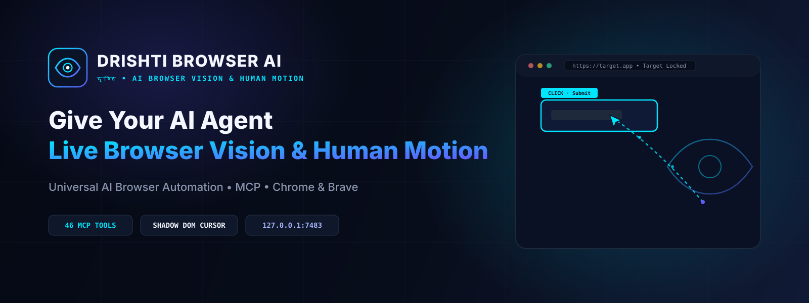
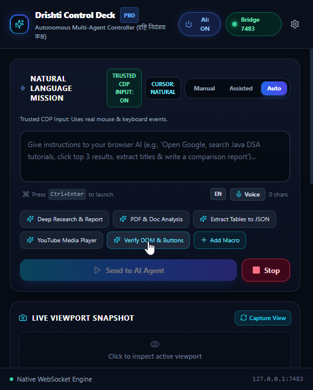
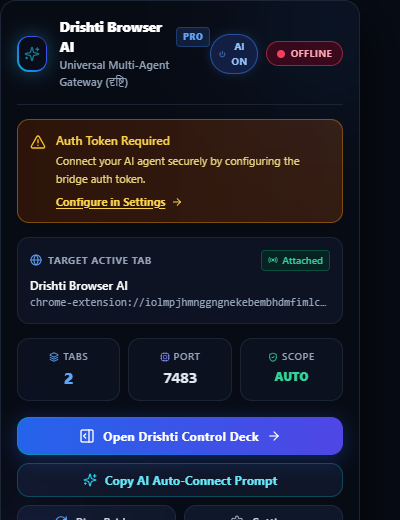
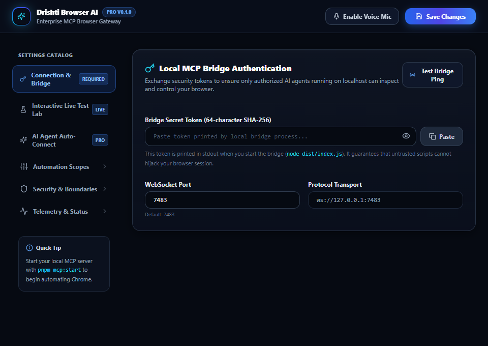
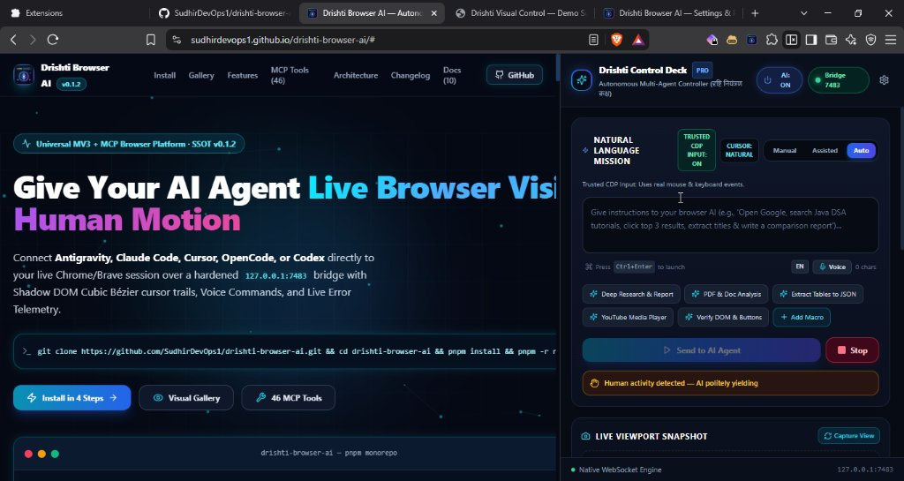
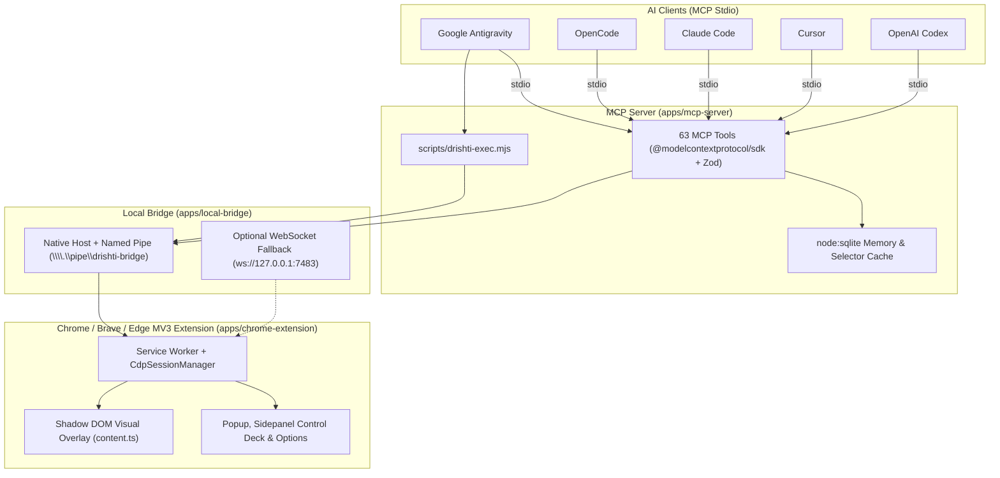

<p align="center">
  
</p>

<p align="center">
  
</p>

<h1 align="center">Drishti Browser AI (दृष्टि) — v0.1.3</h1>

<p align="center">
  <strong>AI Browser Vision &amp; Human Motion Platform for Google Chrome &amp; Brave via Model Context Protocol (MCP)</strong><br />
  <em>"Give Your AI Agent Live Browser Vision &amp; Human Motion."</em> — <em>"See the Web. Understand Every Element. Act with Intelligence."</em>
</p>

<p align="center">
  <a href="https://modelcontextprotocol.io"></a>
  <a href="https://developer.chrome.com/docs/extensions/mv3/intro/"></a>
  <a href="https://www.typescriptlang.org/"></a>
  <a href="https://vitest.dev/"></a>
  <a href="https://playwright.dev/"></a>
  <a href="LICENSE"></a>
</p>

<p align="center">
  <a href="https://sudhirdevops1.github.io/drishti-browser-ai/">Live Website</a> •
  <a href="#installation--setup">Installation</a> •
  <a href="#mcp-tools-catalog-63-tools">63 MCP Tools</a> •
  <a href="#security--privacy-architecture">Security</a> •
  <a href="docs/windows-install.md">Windows Guide</a> •
  <a href="docs/troubleshooting.md">Troubleshooting</a>
</p>

---

## Introduction

**Drishti Browser AI** connects autonomous AI coding agents (**Google Antigravity**, **OpenCode**, **Claude Code**, **Cursor**, **OpenAI Codex**) directly to your real, daily **Google Chrome**, **Brave**, **Microsoft Edge**, or **Chromium** browser session via **OS Native Messaging (`com.drishti.bridge`) + Named Pipe (`\\.\pipe\drishti-bridge`)** (with automatic `ws://127.0.0.1:7483` WebSocket fallback).

Unlike headless browser scrapers that lose your logged-in sessions or operate invisibly, Drishti runs inside your live browser profile with:
- **Zero-Token Native Pipe + On-Demand Power Switch**: Browser spawns the bridge on demand via `chrome.runtime.connectNative` (no manual `pnpm bridge:start` or token copy-paste), and the Popup **`Turn OFF` / `Turn ON`** button lets you cleanly disconnect and shut down the Native Host anytime.
- **Persistent CDP Sessions**: `CdpSessionManager` attaches `chrome.debugger` once per target tab across clicks, `evaluate`, and `printToPDF` (2s attach guard, auto-detaching after 60s idle).
- **Compact Disk Screenshots**: `browser_screenshot({ path })` saves PNG/JPEG to disk and returns ~50-token metadata (pass `inline: true` when base64 is needed).
- **Target Tab Locking** to bind automation to a single chosen tab.
- **Shadow DOM Visual Control Overlay** (`36x36` cubic Bezier cursor, fading SVG trail, collision-free action badges, click ripples, drag trajectories, scroll progress bar, and live typing counters).

---

## Actual Application Screenshots (`v0.1.2`)

| Drishti Control Deck (`v0.1.2` Sidepanel) | Extension Gateway (`MCP ONLINE`) |
|:---:|:---:|
|  |  |

| Local MCP Bridge Settings (`127.0.0.1:7483`) | Live Browser + Control Deck Session |
|:---:|:---:|
|  |  |

---

## Key Capabilities & Feature Status

| Capability | Status | Details |
|---|---|---|
| **Target Tab Locking** | Implemented | Lock any tab via the crosshair control; all MCP actions target that tab without interrupting your other tabs. |
| **Shadow DOM Visual Overlay** | Implemented | Isolated `#drishti-visual-overlay` with `36x36` Bezier cursor, collision-aware badges, click ripple, drag line, scroll track, and 3s auto-cleanup. |
| **Trusted CDP Input** | Implemented | Real `Input.dispatchMouseEvent` via `chrome.debugger` (with DevTools `already attached` guard) and DOM fallback. |
| **Self-Healing Selectors & SQLite Cache** | Implemented | Fuzzy matching (`label[for]`, `aria-label`, `placeholder`, `:has-text`) + `node:sqlite` learned-selector persistence. |
| **Silent & OS-Assisted Downloads** | Implemented | `chrome.downloads` `saveAs: false` routing to `drishti-downloads/` + optional `scripts/auto_save.py` Win32 `#32770` confirmer. |
| **Live Console & Network Telemetry** | Implemented | MAIN-world hooks stream `console.error` and `4xx`/`5xx` `fetch`/`XHR` failures to the Sidepanel drawer. |
| **Bilingual Voice Commands (`EN`/`HI`)** | Experimental | Web Speech API (`en-IN` / `hi-IN`) voice input and repeatable 1-click macro chips in `chrome.storage.local`. |

---

## Supported AI Clients & Browsers

- **AI Clients:** Google Antigravity (`drishti-browser-agent` skill), OpenCode, Claude Code, Cursor, OpenAI Codex (via `@drishti-browser-ai/mcp-server` stdio JSON-RPC).
- **Browsers:** Google Chrome and Brave Browser (Chromium Manifest V3).

---

## System Architecture



---

## MCP Tools Catalog (63 Tools)

Registered tool definitions live in `apps/mcp-server/src/tools/index.ts`; parameter schemas and examples are documented in [docs/mcp-tools-reference.md](docs/mcp-tools-reference.md).

| Category | Count | Registered Tools |
|---|---|---|
| **Browser Core** | 7 | `browser_bridge_health`, `browser_status`, `browser_observe`, `browser_snapshot`, `browser_screenshot`, `browser_inspect`, `browser_confirm` |
| **Navigation** | 6 | `browser_navigate`, `browser_back`, `browser_forward`, `browser_reload`, `browser_wait`, `browser_wait_for` |
| **Tab Management** | 6 | `browser_list_tabs`, `browser_switch_tab`, `browser_new_tab`, `browser_close_tab`, `browser_use_tab`, `browser_group_tabs` |
| **Interaction** | 10 | `browser_click`, `browser_double_click`, `browser_hover`, `browser_type`, `browser_fill`, `browser_press_key`, `browser_scroll`, `browser_scroll_into_view`, `browser_select`, `browser_drag` |
| **Content Extraction** | 5 | `browser_get_text`, `browser_get_links`, `browser_find_element`, `browser_get_tables`, `browser_get_forms` |
| **Automation & Downloads** | 10 | `browser_get_page_info`, `browser_batch_compare`, `browser_download`, `browser_wait_download`, `browser_handle_save_dialog`, `browser_execute_workflow`, `browser_verify_action`, `browser_task`, `browser_task_status`, `browser_stop_task` |
| **Debugging & Telemetry** | 3 | `browser_console`, `browser_get_errors`, `browser_network_inspect` |
| **Workflow & Memory** | 8 | `browser_get_missions`, `browser_update_mission`, `browser_memory`, `workflow_start`, `workflow_stop`, `workflow_run`, `workflow_list`, `workflow_match` |

---

## Installation & Setup

### 🤖 1-Prompt AI Auto-Install & Setup (Any AI Agent — Zero-Clone Safe)

Give this single prompt to **Google Antigravity**, **Gemini CLI**, **OpenCode**, **Claude Code**, **Cursor**, or **OpenAI Codex** — it checks if Drishti is already installed, registers Native Messaging across Chrome/Brave/Edge/Chromium (zero token needed), configures your AI client, and installs the `drishti-browser-agent` skill:

```markdown
<DRISHTI_AUTO_INSTALL>
Set up Drishti Browser AI (दृष्टि) for me so you can control my Chrome/Brave/Edge browser via MCP:
1. First check if Drishti Browser AI is already installed locally (look for `apps/mcp-server/dist/index.js`).
   - Only clone https://github.com/SudhirDevOps1/drishti-browser-ai.git into a dedicated tools folder (NOT inside my current project) if it is not installed yet, then run `pnpm install && pnpm -r run build`.
2. Inside the Drishti folder, run `pnpm native:install && pnpm setup:agent -- --client <your_client>` (or `auto`):
   - Registers Native Messaging (`com.drishti.bridge`) for Chrome, Brave, Edge & Chromium (no manual `pnpm bridge:start` or token copy-paste needed).
   - Registers `drishti-browser-ai` (63 MCP tools; supports `DRISHTI_LAZY_TOOLS=1`) in that AI client's MCP config.
   - Installs `drishti-browser-agent/SKILL.md` into that client's skills directory.
3. Clean up any temporary setup files; if freshly cloned solely for runtime use, remove non-runtime folders (`apps/web-showcase`, `tests`) after building.
4. Tell me to reload `extension-ready-to-install/` once in `chrome://extensions/` (or `brave://extensions/`) and verify it auto-connects.
</DRISHTI_AUTO_INSTALL>
```

### 1. Clone, Install, Build & Register Native Host
```bash
git clone https://github.com/SudhirDevOps1/drishti-browser-ai.git
cd drishti-browser-ai
pnpm install
pnpm -r run build
pnpm native:install
```
`pnpm -r run build` compiles all 11 workspace packages and bundles `apps/chrome-extension/dist/`. `pnpm native:install` registers Native Messaging for Chrome, Brave, Edge, and Chromium.

### 2. Load the Extension in Chrome, Brave, or Edge
1. Open `chrome://extensions/` (or `brave://extensions/` / `edge://extensions/`).
2. Enable **Developer mode** (top-right).
3. Click **Load unpacked** and select `extension-ready-to-install/` (or `apps/chrome-extension/dist`).
4. Pin **Drishti Browser AI** to the toolbar — it auto-connects with zero token setup.

### 3. Configure Auth Token & Start the Local Bridge (On-Demand)
Generate or auto-configure a 64-character token without committing `.drishti-token`:
```bash
node scripts/setup-agent.mjs --client auto
```
Start the Local Bridge on demand:

```powershell
# PowerShell (Windows)
$env:BRIDGE_AUTH_TOKEN = "<YOUR_64_CHAR_BRIDGE_TOKEN>"
pnpm bridge:start
```

```bash
# Bash (macOS / Linux / Git Bash)
export BRIDGE_AUTH_TOKEN="<YOUR_64_CHAR_BRIDGE_TOKEN>"
pnpm bridge:start
```

Then open **Extension Settings -> Connection & Bridge**, paste `<YOUR_64_CHAR_BRIDGE_TOKEN>`, click **Save Changes**, and run **Test Bridge Ping** to confirm `ONLINE`. *(Note: `setup:agent` installs `SKILL.md` for Antigravity, Gemini CLI, OpenCode, Claude Code, and Codex, and writes `~/.cursor/mcp.json` for Cursor.)*

### 4. MCP Client Configuration
See [docs/agent-integrations.md](docs/agent-integrations.md) and [configs/agent-configs.md](configs/agent-configs.md) for ready-to-use snippets for Antigravity, Claude Code, Cursor, OpenCode, and Codex.

---

## Security & Privacy Architecture

Detailed documentation: [docs/privacy-and-security.md](docs/privacy-and-security.md) and [SECURITY.md](SECURITY.md).

- **Localhost-Only Transport:** Bridge binds strictly to `127.0.0.1:7483` and rejects non-extension browser origins (CSWSH protection).
- **Token Authentication:** Constant-time comparison against a 64-character secret token (`BRIDGE_AUTH_TOKEN` / `.drishti-token`). Never expose or commit your token.
- **No MV3 `eval()` Sinks:** Arbitrary `eval()` / `new Function()` execution is disabled inside the extension.
- **Password Field Protection:** `typeText` refuses `input[type="password"]` targets.
- **Human-in-the-Loop Controls:** Master `AI: ON / PAUSED` switch, `Stop` emergency halt, domain allowlist/blocklist policies, and Human Takeover Yield (`mousedown` / `keydown` pauses AI briefly).
- **Untrusted Web Content:** Page DOM and text are treated strictly as untrusted data and cannot override extension policies.

---

## Known Limitations & Troubleshooting

- Chrome MV3 prevents scripting on `chrome://`, `brave://`, `chrome-extension://`, and Chrome Web Store URLs.
- Background/minimized tabs may throttle `captureVisibleTab` (`CAPTURE_THROTTLED` guard backs off automatically).
- See [docs/limitations.md](docs/limitations.md) and [docs/troubleshooting.md](docs/troubleshooting.md) for full details.

---

## Development, Build & Testing

```bash
pnpm version:verify   # Verify SSOT version sync across workspaces & docs
pnpm -r run typecheck # Run TypeScript strict checks across all packages
pnpm -r run build     # Build all apps & packages (includes tsc --noEmit)
pnpm test             # Run Vitest unit suite (7 files, 28 tests)
pnpm test:e2e         # Run Playwright Chromium extension E2E smoke tests
```

---

## Project Structure

```text
drishti-browser-ai/
├── apps/
│   ├── chrome-extension/   # MV3 React 18 + Tailwind + Vite extension
│   ├── local-bridge/       # On-demand 127.0.0.1:7483 WebSocket bridge
│   ├── mcp-server/         # 46-tool MCP stdio server + SQLite cache
│   └── web-showcase/       # Public showcase website & SVG brand assets
├── packages/
│   ├── browser-core/       # Controller & observer abstractions
│   ├── dom-engine/         # Semantic DOM, forms, tables, links
│   ├── mcp-tools/          # Tool catalog & shared definitions
│   ├── permission-engine/  # Domain allowlist/blocklist policy engine
│   ├── shared-types/       # Shared TypeScript contracts & constants
│   ├── visual-engine/      # Screenshot & visual diff utilities
│   └── workflow-engine/    # Multi-step task execution engine
├── docs/                   # Architecture, setup, tools, security, troubleshooting
├── scripts/                # version.mjs, drishti-exec.mjs, setup-agent.mjs, auto_save.py
└── tests/                  # Vitest unit tests & Playwright E2E smoke tests
```

---

## Documentation Index

- [Windows Installation Guide](docs/windows-install.md)
- [System Architecture](docs/architecture.md)
- [46 MCP Tools Reference](docs/mcp-tools-reference.md)
- [Agent Integrations](docs/agent-integrations.md)
- [Privacy & Security](docs/privacy-and-security.md)
- [Developer Setup](docs/developer-setup.md)
- [Troubleshooting](docs/troubleshooting.md)
- [Known Limitations](docs/limitations.md)
- [Project Status](docs/PROJECT-STATUS.md)

---

## Roadmap

- Cross-frame (`iframe`) visual box projection refinement.
- Expanded Playwright visual regression assertions against `apps/chrome-extension/tests/visual-fixture.html`.
- Additional MCP client auto-configuration templates.

---

## Contributing

Contributions are welcome. Please follow Conventional Commits (`feat:`, `fix:`, `docs:`, `security:`, `chore:`), keep UI vector-only (`lucide-react`), and run `pnpm version:verify`, `pnpm -r run typecheck`, `pnpm -r run build`, `pnpm test`, and `pnpm test:e2e` before opening a PR.

---

## License & Credits

[MIT](LICENSE) © [Sudhir Kumar (@SudhirDevOps1)](https://github.com/SudhirDevOps1) — Drishti Browser AI (दृष्टि).
